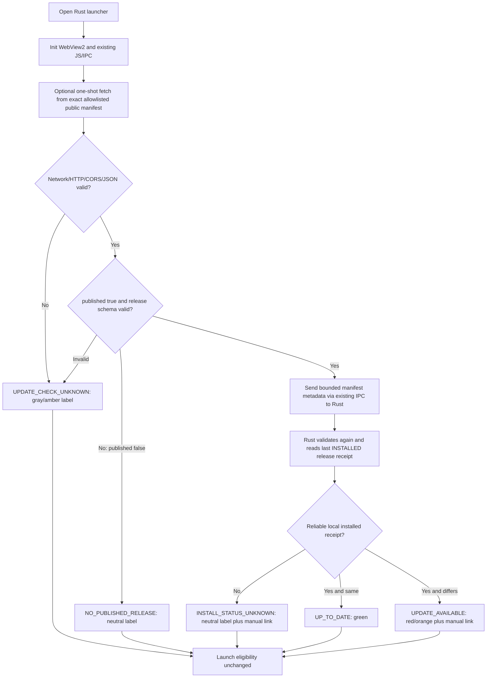

# L850 Update Notice — WebView2 Fetch & Manual Drive Button Review

```text
DATE=2026-10-10
MODE=DESIGN_REVIEW_ONLY
STATUS=PLANNED_PAUSED
PUBLIC_REPO=8xbwvwd8c9-code-taka/L850-public-updates
PRIVATE_RUST_OWNER_BRANCH=work/850-rust-launcher
NO_NEW_IPC_FRAMEWORK=YES
NO_NEW_TLS_LIBRARY=YES_UNLESS_NEEDED
WEBVIEW2_FETCH=CONDITIONAL_PENDING_REAL_WINDOWS_CORS_TEST
IPC=REUSE_EXISTING_WRY_CHANNEL
PUBLIC_MANIFEST=stable/manifest.json
LIVE_MANIFEST_PUBLISHED=FALSE
NO_RELEASE_TO_DISPLAY=YES
AUTO_DOWNLOAD=NO
AUTO_EAT=NO
NEW_RUST_CODE=NO
```

## User feedback and technical disposition

**Proposal 1: use the existing WebView2 front-end JavaScript `fetch()` to retrieve the public GitHub Raw manifest, and send a bounded result to Rust over the already existing Wry IPC.** Direction is ACCEPTED **conditionally**, not verified or implemented.

- Actual private Rust code (`launcher/850Rust/src/gui.rs`) uses `WebViewBuilder::new(...).with_html(...).with_ipc_handler(...)`. HTML JS already has `send()` and a `window.L850` object in `launcher/850Rust/ui/index.html`. Reuse these paths; do not create a new IPC or watcher.
- With `wry 0.45`, `with_html()` content has **null Origin**. A cross-origin `fetch('https://raw.githubusercontent.com/8xbwvwd8c9-code-taka/L850-public-updates/main/stable/manifest.json')` depends on the remote response CORS headers for the actual WebView2 origin. **CORS is NOT verified** from the owning Windows GUI; anonymous HTTP reachability and response `Access-Control-Allow-Origin` still need a real controlled test. A browser opening a URL is insufficient.
- Do **not** use `fetch({mode:'no-cors'})` to bypass CORS: the returned opaque body cannot be read, parsed or authenticated.
- `fetch()` uses the installed WebView2 networking/TLS implementation. This avoids a large new Rust HTTPS crate for a one-file feature **if the CORS test passes**. Do not promise particular EXE size reductions or guaranteed compatibility without measuring Windows x86 builds.
- If CORS/Origin/network behavior fails, **fallback design** is an OS WinHTTP read-only HTTPS request from Rust, reusing Windows TLS and avoiding the required addition of `reqwest`/OpenSSL. This is only an alternate plan, **not authorization to implement it**. Neither add CORS-bypass flags nor a proxy/cloud service.

## Proposed logic — not deployed



**Important correction to feedback:** `CheckFailed` must **not** keep the **update status** green, because this falsely says latest version is proven. Network/CORS failure is `UPDATE_CHECK_UNKNOWN` (gray/amber). The **separate existing game-launch readiness indicator and Launch button** remain unchanged/enabled or disabled only according to their existing launcher gates. No update result is allowed to gate the first client-only smoke.

## Network and trust boundaries

- Exact public raw URL is in `README.md`; allow **HTTPS GET** only, one automatic request at startup, optional explicit `檢查更新` retry. Timeout suggestion: 5 seconds via `AbortController`, `cache:'no-cache'` if necessary. Limit response size (e.g. 16 KiB), validate `response.ok`, schema 1, `channel=stable`, `published` and nested `release`.
- Use a deliberate typed, bounded IPC message such as `UpdateManifestObserved { manifest_json: String }` for Rust parse+validation. Reject arbitrary JS command names, unknown schema versions, extra keys, invalid redirect/Drive hosts, malformed sha256, `published=true` with zero size or fake release ID, and unexpectedly large data. A JS-originating result is **untrusted**, even if it came through a known WebView; check expected WebView origin/navigation and keep IPC restricted to the embedded UI. Do not allow this read-only message to invoke game actions, write Helper settings, spawn arbitrary programs or update the installed version receipt.
- Do not render remote `display_version` or release notes using `innerHTML`; use `textContent`. The remote JSON can direct only a **manual** approved Google Drive URL. Validate a fixed `drive.google.com` HTTPS file-share URL and restrict external open to this known parsed/approved URL; prefer existing Rust host outbound-browser handling (or a narrow explicitly bounded host callback later), never generic JS `open any URL` IPC.
- Rust app ships **no Google API key**, OAuth refresh token, service account key, or GitHub PAT.
- `manifest.published=false,release=null` is current truthful live data. It must not show `UP_TO_DATE`, `UPDATE_AVAILABLE`, a downloadable latest release, or false A/B content.

## Two buttons and indicators — approved UX proposal only

| Update state | Update indicator | `檢查更新` click | `雲端硬碟` click | Game launch |
| --- | --- | --- | --- | --- |
| Verified installed ID = published latest | GREEN · 已是最新 | Re-fetch manifest and recompare | Open approved manual Drive fallback or published release link | Existing gate only |
| Installed ID differs from published release | RED/ORANGE · 有新檔案 | Re-fetch; then show `下載最新更新` separate action if desired | Open latest manifest Drive page | Existing gate only |
| No reliable installed receipt | GRAY · 安裝版本未知 | Re-fetch | Open approved Drive page when known | Existing gate only |
| fetch/CORS/HTTP/schema error | GRAY/AMBER · 無法檢查更新 | Retry on user action | Open *previously approved* static Drive fallback if known, otherwise disabled with explanation | Existing gate only |
| `published=false` | NEUTRAL · 尚未發布更新 | Re-fetch | Manual fallback **only if** a separately verified/approved URL exists | Existing gate only |

**Semantics:** `檢查更新` means *recheck*, not *open download*. To match the user feedback that both buttons should lead to Drive on RED, prefer an explicit `下載最新更新` CTA shown after detection, alongside `雲端硬碟` which always opens the latest approved link. If product insists on repurposing `檢查更新` under RED, its label **must change visibly** to `下載更新` (do not make the same-labeled check control silently navigate). Green is strictly "proved up-to-date" and not "network failed but we don't block game".

The future Rust UI may keep a separately configured **approved fallback** Google Drive browser share URL for the green/offline cases; never invent a public download URL or take an unvalidated URL from a public JSON message. Because release is currently unpublished, no new URL is committed or claimed valid.

## Agent review task while paused

```text
TASK_ID=L850-WEBVIEW2-FETCH-IPC-NOTICE-SCOPE-REVIEW-20261010
TARGET=Evaluate reuse of existing wry 0.45 with_html and IPC for future read-only manifest notice; correct indicator and button semantics
KNOWN=Actual private gui.rs with_html + with_ipc_handler; ui/index.html send; public stable manifest published=false; public repo metadata-only
DO=Read public README/CURRENT/AGENT_TASK and this spec; review cross-origin `null` origin, schema, bounded IPC, and UX; record technical blockers only
PASS=Plan clearly gates real Windows x86 anonymous+CORS tests, confines update status UNKNOWN separately from launch readiness, retains manual Drive fallback, and does not publish release
STOP=Implement Rust, change GUI, launch game, modify HTML, create DLL, call update binaries, open ports, publish manifest, make check mandatory, unpause auto download/eat
RETURN=PLAN_ONLY|WEBVIEW_FETCH=CONDITIONAL|CORS=UNTESTED|STATUS_LAMP_FIX=YES|BUTTONS=SPECIFIED|SOURCE_TOUCHED=NO
```

References:
- Wry with_html origin `null` and custom protocol CORS: https://docs.rs/wry/0.45.0/wry/struct.WebViewBuilder.html
- Microsoft WebView2 message/native trust boundary: https://learn.microsoft.com/en-us/microsoft-edge/webview2/concepts/security
- CORS `no-cors` opaque rule: https://developer.mozilla.org/en-US/docs/Web/HTTP/Guides/CORS/Errors
